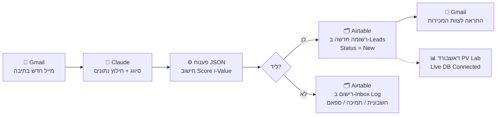

# PV Lab Germany — אוטומציית קליטת לידים מ-Gmail (Blueprint)

אוטומציה שמחברת **Gmail ← Claude (AI) ← Airtable ← Gmail**, ומזינה ישירות את
[דאשבורד הלידים של PV Lab Germany](https://github.com/Rakefet-gif/pvlab-leads-dashboard).

כל מייל חדש בתיבה נשלח ל-Claude, שמחליט אם זו **פניית B2B חדשה (ליד)**, חשבונית, תמיכה, ספאם או אחר.
אם זה ליד, Claude מחלץ את החברה, איש הקשר, סוג השירות, היקף ה-MW ופרוטוקול הבדיקה. האוטומציה מחשבת
את ציון ה-AI ואת השווי **באותה נוסחה של הדאשבורד**, יוצרת רשומה בטבלת `Leads` בסטטוס `New`, ושולחת התראה לצוות המכירות.
מיילים שאינם לידים נרשמים בטבלת `Inbox Log`.

הריפו מכיל את ה-**Blueprint** — מבנה האוטומציה כקובץ JSON שאפשר לייבא ולהריץ — בשתי פלטפורמות:

| קובץ | פלטפורמה | איך מייבאים |
|---|---|---|
| [`blueprints/make/pvlab-gmail-lead-intake.make-blueprint.json`](blueprints/make/pvlab-gmail-lead-intake.make-blueprint.json) | **Make.com** | Scenarios ← Create new ← תפריט `⋯` ← **Import Blueprint** |
| [`blueprints/n8n/pvlab-gmail-lead-intake.n8n-workflow.json`](blueprints/n8n/pvlab-gmail-lead-intake.n8n-workflow.json) | **n8n** | Workflows ← תפריט `⋯` ← **Import from File** (או הדבקה של ה-JSON ישירות לקנבס) |

## תרשים הזרימה



## הרכיבים

| # | רכיב | תפקיד |
|---|---|---|
| 1 | **Gmail — Watch emails** | טריגר: מושך מיילים חדשים מה-Inbox (בלי Promotions / Social) |
| 2 | **Claude API** (`claude-haiku-5-5`) | מקבל נושא, שולח וגוף המייל ומחזיר JSON: `category`, `is_lead`, `company`, `contact`, `service`, `mw`, `protocol`, `summary` |
| 3 | **פענוח וחישוב** | ממיר את התשובה לשדות ומחשב `Score = min(99, max(55, round(52 + MW×0.35 + (Bankability ? 12 : 6))))` ו-`Value = MW × 520`, בדיוק כמו `calcScore` בדאשבורד |
| 4 | **Router / IF** | מפצל לפי `is_lead` |
| 5 | **Airtable — Leads** | יוצר ליד חדש בטבלה שהדאשבורד קורא ממנה |
| 6 | **Gmail — Send** | מתריע לצוות המכירות עם שם החברה, MW וציון |
| 7 | **Airtable — Inbox Log** | מתעד כל מייל שאינו ליד עם הקטגוריה והסיכום |
| 8 | **Gmail — Mark as Read** (ב-n8n) | מסמן את המייל כמטופל כדי שלא יעובד פעמיים |

ההנחיה ל-Claude נמצאת ב-[`prompts/classifier-system-prompt.md`](prompts/classifier-system-prompt.md).

## הכנה ב-Airtable

**טבלת `Leads`** — כבר קיימת אם הדאשבורד מחובר (המבנה ב-[SPEC.md](https://github.com/Rakefet-gif/pvlab-leads-dashboard/blob/main/SPEC.md)):
`Company`, `Contact`, `Service`, `MW`, `Value`, `Score`, `Status`, `Protocol`.

**טבלת `Inbox Log`** — חדשה, באותו Base:

| שדה | סוג |
|---|---|
| `Subject` | Single line text (שדה ראשי) |
| `From` | Single line text |
| `Category` | Single select (`invoice`, `support`, `spam`, `other`) |
| `Confidence` | Number (2 ספרות אחרי הנקודה) |
| `Summary` | Long text |
| `Received` | Single line text |

הרשומות נשלחות עם `typecast: true`, כך שאפשרויות חסרות ב-Single select נוצרות לבד.

## מה להחליף אחרי הייבוא

ה-Blueprint לא כולל מפתחות או חיבורים — רק את המבנה. אחרי הייבוא:

1. **חיבורים:** בכל מודול Gmail ו-Airtable בוחרים חיבור (Connection / Credential) משלכם.
2. **Base ID:** מחליפים את `appXXXXXXXXXXXXXX` ב-Base ID של PV Lab (אותו אחד שמוזן בדאשבורד).
3. **מפתח Claude:**
   * **Make:** במודול 3 (HTTP) מחליפים `YOUR_ANTHROPIC_API_KEY` במפתח מ-[console.anthropic.com](https://console.anthropic.com). עדיף לשמור אותו ב-Keychain של Make.
   * **n8n:** יוצרים Credential מסוג **Header Auth** עם השם `x-api-key` והמפתח כערך.
4. **כתובת להתראות:** מחליפים את `sales@your-domain.example` בכתובת של צוות המכירות.
5. **Make בלבד:** מריצים פעם אחת עם **Run once** כדי שמודול 4 (Parse JSON) ילמד את מבנה התשובה, ואז מוודאים שהשדות במודולים 6–8 ממופים. אם שדה מסומן באדום אחרי הייבוא (למשל שם שדה השולח של Gmail), ממפים אותו מחדש מהרשימה.

## בדיקה

```bash
python3 scripts/build_blueprints.py   # מייצר את שני קבצי ה-JSON מהגדרה אחת
python3 scripts/validate.py           # בדיקות אופליין (דורש Node.js)
```

`validate.py` בודק שה-JSON תקין, שכל ההפניות בין המודולים קיימות, שגוף הבקשה ל-Claude נבנה כ-JSON תקין,
ומריץ את קוד הפענוח של n8n על [ארבעה מיילים לדוגמה](samples/sample-emails.json) (שני לידים, חשבונית ושאלת תמיכה).
כשריפו הדאשבורד נמצא בתיקייה שכנה, הסקריפט לוקח ממנו את `calcScore` ומוודא שהציון זהה.

בדיקה חיה: שולחים לתיבה את אחד המיילים מ-`samples/sample-emails.json`, ותוך דקה הליד מופיע בדאשבורד בסטטוס **New**.

## אבטחה

* לא שומרים מפתחות API, טוקנים או Base ID אמיתי בריפו — הוא ציבורי.
* טוקן ה-Airtable צריך רק `data.records:read` ו-`data.records:write`, מוגבל ל-Base של PV Lab.
* Claude מקבל רק את 8,000 התווים הראשונים של גוף המייל, בלי קבצים מצורפים.

## מבנה הריפו

```
blueprints/make/   ← Blueprint לייבוא ב-Make.com
blueprints/n8n/    ← Workflow לייבוא ב-n8n
prompts/           ← ההנחיה ל-Claude (מקור אחד לשתי הפלטפורמות)
samples/           ← מיילים לדוגמה לבדיקה
scripts/           ← יצירת ה-Blueprints ובדיקתם
```
